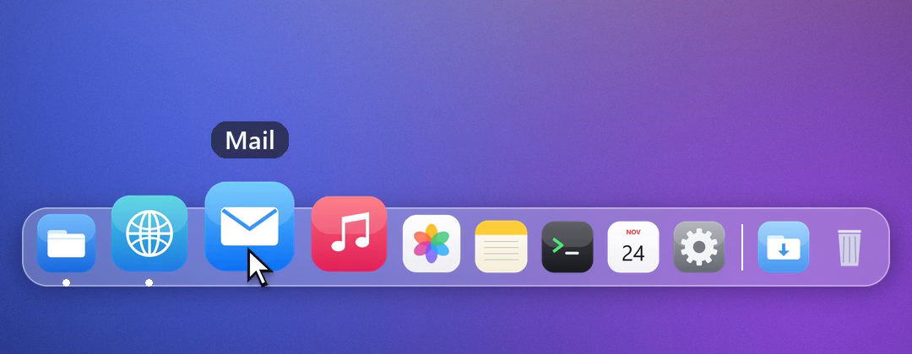
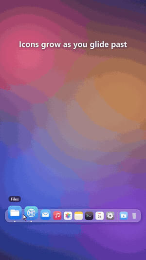

# WinDock

**A Mac-style dock for Windows 11.** Free, open source (MIT), no admin rights, no telemetry.



WinDock replaces the Windows taskbar with a translucent dock at the bottom of the screen. Quit it and the taskbar
comes back exactly as it was.

**[⬇ Download the latest version](../../releases/latest)** · [What it does](#what-it-does-today) ·
[Install](#install) · [FAQ](#faq) · [Roadmap](#roadmap)

<p align="center"></p>
<p align="center"><sub>Animated illustration of WinDock's features (drawn from code, not a screen recording).</sub></p>

## What it does today

**The dock**
- Icons grow as the pointer glides past (magnification), with name labels and dots under running apps.
- Click an app to open it (it bounces while it starts). Click a running app to minimise it with a genie effect into
  its icon; click again to bring it back.
- Live window previews when you hover a running app, including apps with several windows.
- Folders open as stacks: **Fan**, **Grid** or **List**, with colour tags and "Open in Explorer".
- Drag icons to reorder them; drag one off the dock to remove it (with a "poof").
- Trash shows full / empty; right-click to empty it. Website pins show the site's icon.
- Auto-hide: the dock slides away and comes back when the pointer touches the bottom edge.
- Maximised windows stop above the dock. Light and dark appearance follow Windows.
- Light on resources: about 0.05 % CPU when idle and about 13 MB of memory.

**Settings**
- A Settings window in the style of macOS System Settings, with search.
- Dock size, magnification, appearance and hiding the Windows taskbar all change live.
- Settings are a plain text file you can edit by hand: `%APPDATA%\WinDock\windock.txt`.

The menu bar, Launcher, search, window overview, Mac-style window buttons and file browser are planned (see the
[Roadmap](#roadmap)) but not built yet.

## Requirements

- Windows 11 (made and tested on Windows 11; Windows 10 may work but is not tested).
- .NET Framework 4.x, which is already part of Windows 10 and 11. Nothing else to install.
- The dock sits on the main screen.

## Install

1. Download **`WinDock-Setup-<version>.exe`** from the [Releases](../../releases) page.
2. Double-click it and choose **Install**. It installs for your account only; no admin rights are needed.
3. The dock appears at the bottom of the screen. WinDock is also in the Start menu.

**"Windows protected your PC"?** WinDock is not code-signed (signing certificates cost money), so Microsoft
Defender SmartScreen may warn about a new download. Choose **More info → Run anyway**. You can check the download
against `SHA256SUMS.txt` on the release page:

```powershell
Get-FileHash .\WinDock-Setup-0.1.0.exe -Algorithm SHA256
```

**Smart App Control:** if Smart App Control is turned on (Windows Security → App & browser control), Windows blocks
every app that is not signed with a paid certificate, including WinDock, and it can't be allowed one app at a time.

**Portable:** prefer no installer? Download `WinDock-<version>-portable.zip`, unzip it and double-click
`Install.bat`.

## Use

- **Settings:** right-click empty space on the dock → Dock Settings…, or start WinDock again from the Start menu.
- **Quit:** right-click the dock → Quit WinDock. The Windows taskbar comes back.
- **If WinDock ever stops unexpectedly** and the taskbar is still hidden, run
  `%LOCALAPPDATA%\WinDock\WinDock.exe /restore`, or sign out and back in.

## Uninstall

**Settings → Apps → Installed apps → WinDock → Uninstall.** This stops WinDock, brings the taskbar back and removes
the program, its Start menu shortcut and start-at-sign-in entry. Your settings stay in `%APPDATA%\WinDock`; delete
that folder too if you want nothing left behind.

## FAQ

**Does WinDock change Windows settings?**
Only while it runs: it hides the taskbar and reserves space at the bottom of the screen for the dock. It notes the
taskbar's original state first and puts it back when you quit or uninstall. Everything it stores is in your own
profile (`%LOCALAPPDATA%\WinDock` for the program, `%APPDATA%\WinDock` for settings).

**The taskbar is gone and WinDock isn't running. How do I get it back?**
Run `%LOCALAPPDATA%\WinDock\WinDock.exe /restore`, or sign out and back in. If WinDock is already uninstalled,
open Task Manager and restart **Windows Explorer**.

**Can I keep the Windows taskbar as well?**
Yes: Settings → turn off **Hide the Windows taskbar**.

**Why does Windows warn me when I open the installer?**
WinDock isn't code-signed yet, so SmartScreen doesn't know it. See [Install](#install) for how to check the download
and run it.

**Does it need the internet?**
No. See [Privacy](#privacy).

**Is it made by Apple or Microsoft?**
No. It's an independent open-source project and uses no Apple artwork.

## Roadmap

- [x] Dock, folder stacks, previews, Trash, auto-hide (milestone 2)
- [x] Settings window, installer, uninstall from Settings → Apps
- [ ] Menu bar with a System menu and app menus
- [ ] Launcher (all apps) and Search
- [ ] Mac-style window buttons on every window
- [ ] Status pill and Quick Panel
- [ ] Overview of all windows, touchpad gestures
- [ ] Files (a file browser)

The full behaviour of every feature is written down in [SPEC.md](SPEC.md).

## Reporting bugs and contributing

- **Found a bug?** Open an [issue](../../issues) with your Windows version, what you did and what happened. If
  WinDock logged an error, attach `%APPDATA%\WinDock\windock.log`.
- **Have an idea?** Open an issue first, so we can agree on it before you write code.
- **Want to send a fix?** Build with `build.bat`, keep to the behaviour in [SPEC.md](SPEC.md) and describe what you
  tested in the pull request. Pull requests are built and tested automatically.

## Build from source

No SDK needed: the C# compiler that ships with Windows (.NET Framework 4.x) is enough.

- `build.bat` → `bin\WinDock.exe`
- `build-release.bat` → `dist\` with the installer, the portable zip and `SHA256SUMS.txt`. It only builds;
  nothing is installed or run.

Every push is built and tested on a clean Windows machine by GitHub Actions (`.github/workflows/build.yml`): the
installer is run silently, the install is checked, then it is uninstalled and checked again. Pushing a tag such as
`v0.1.0` also publishes a GitHub Release with the files from `dist\`.

Setup also has a silent mode for scripted installs: `WinDock-Setup-0.1.0.exe /S [/noautostart] [/nostart]`.

## Privacy

WinDock makes no network connections except fetching a website's icon once when you pin that website to the dock.
No telemetry, no accounts.

## Licence

MIT, see [LICENSE](LICENSE).

WinDock is an independent project. It is not affiliated with, endorsed by or connected to Apple Inc. or Microsoft
Corporation. macOS is a trademark of Apple Inc.; Windows is a trademark of Microsoft Corporation.
